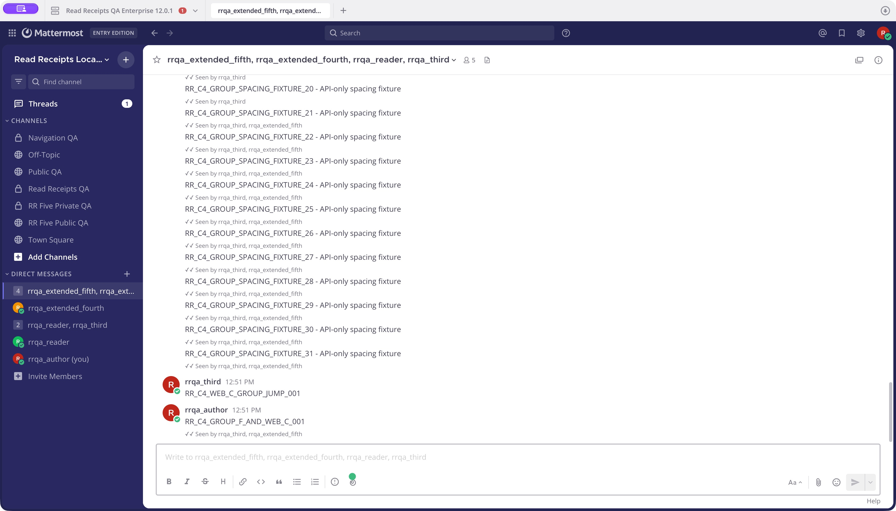

# تیک دیده‌شدن پیام در مترماست

[English](README.md) · [دریافت نسخه‌ها](https://github.com/ghaffaria/Mattermost-Read-Receipts-plugin/releases) · [معماری](docs/ARCHITECTURE.fa.md) · [گزارش آزمون](docs/VALIDATION.fa.md)

پلاگین **1.1.2** و کلاینت جداگانهٔ اندروید **2.46.0-rr.1** رسید مستقل هر پیام را ثبت می‌کنند. پیام باید به‌صورت پیش‌فرض **دو ثانیهٔ پیوسته** در گفتگوی فعال و پنجرهٔ دارای فوکوس دیده شود. فرستنده علامت **✓✓ Seen by …** و خوانندگان تأییدشدهٔ سرور را می‌بیند. دریافت پیام یا cursor خواندن کانال به‌تنهایی رسید نمی‌سازد.

## دانلود و نصب

[پلاگین 1.1.2 و SHA256SUMS](https://github.com/ghaffaria/Mattermost-Read-Receipts-plugin/releases/tag/v1.1.2) را دریافت کنید. APK بدون تغییر در [انتشار قبلی اندروید](https://github.com/ghaffaria/Mattermost-Read-Receipts-plugin/releases/tag/v1.1.1-android-2.46.0-rr.1) باقی است. [نصب، حفظ داده و بازگشت](docs/INSTALLATION.fa.md) و [ساخت اندروید](mobile/android/README.fa.md) را بخوانید.

اندروید بر مبنای نسخهٔ رسمی2.46.0 است و با شناسهٔ `com.pardis.mattermost.readreceipts.qa` کنار اپ رسمی نصب می‌شود. اپ رسمی و داده‌های آن حذف یا بازنویسی نمی‌شوند. اپ رسمیِ بدون تغییر این پروتکل سفارشی را پیاده‌سازی نمی‌کند.

## محدودهٔ تأیید

آزمون روی Enterprise12.0.1، schema234، PostgreSQL17.12، برنامهٔ نصب‌شدهٔ مک6.3.2، دو شبیه‌ساز Android16/API36 و وب انجام شده است. ارتباط دوطرفه، کانال عمومی و خصوصی و گروه پنج‌نفره، اسکرول، ترد، نوار اعلان و اتصال دوباره بررسی شده‌اند.

**سازگاری دسکتاپ ویندوز با وب تأیید شد:** اپ رسمی در UTM، دریافت در عمومی/خصوصی، اسکرول خارج از صفحه، minimize/بازگشت و ترد بسته/باز را در آزمون‌های مستند پاس کرد. مسیر برگشت ویندوز به وب نیز رسید معتبر داشت. [گزارش ویندوز و تصاویر](docs/WINDOWS.fa.md) شامل شواهد، پذیرش گزارش‌شدهٔ کاربر و محدودیت نسخه/پوشش است. ساخت اختصاصی ویندوز لازم نیست.

**Push اختصاصی این APK تنظیم و تأیید نشده است.** امضا QA است. گوشی واقعی، سایر نسخه‌های Android، iOS، HA/بار و سیاست‌های Enterprise Advanced پروداکشن تأیید نشده‌اند. در این کار پروداکشن تغییری نکرده است.

تصاویر مربوط به حساب‌های ساختگی آزمایشگاه‌اند. [تصاویر و جزئیات آزمون](docs/VALIDATION.fa.md).

## سورس و تاریخچه

محتوای فعلی مخزن جایگزین نسخهٔ قدیمی شده است؛ commitها و انتشار قبلی برای بازیابی باقی‌اند. سورس سرور و وب در server و webapp، و patch کامل اندروید و ابزار بازسازی در mobile/android هستند. فایل‌های دیتابیس، تنظیمات اجرا، اطلاعات ورود و کلید خصوصی امضا منتشر نمی‌شوند. برای ساخت سرور: `npm ci --prefix webapp`، سپس `make test` و `make dist`.

## مجوز

کد متعلق به پروژه تحت [MPL-2.0](LICENSE) است؛ [دامنهٔ مجوز و کدهای شخص ثالث](LICENSING.md) را بخوانید. در پلاگین 1.1.2 اعتبار توسعه‌دهنده در توضیحات و لینک قابل کلیک در پایین تنظیمات درج شده است. APK و مجوزهای اندروید تغییر نکرده‌اند. آزمون‌های رابط قبلی روی 1.1.1 بودند؛ تغییر 1.1.2 مربوط به مجوز/اعتبار و شمارهٔ نسخهٔ لاگ فعال‌سازی است.
