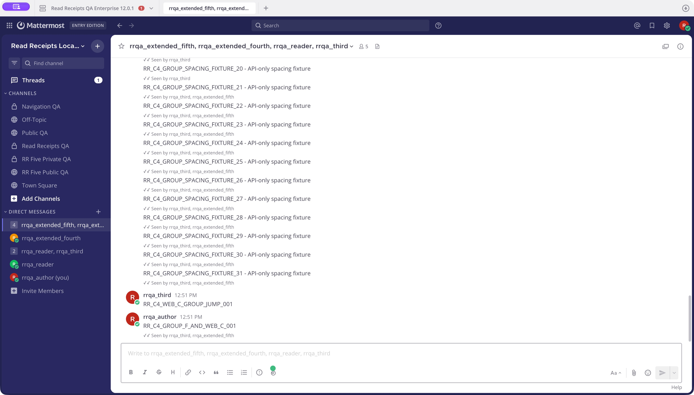
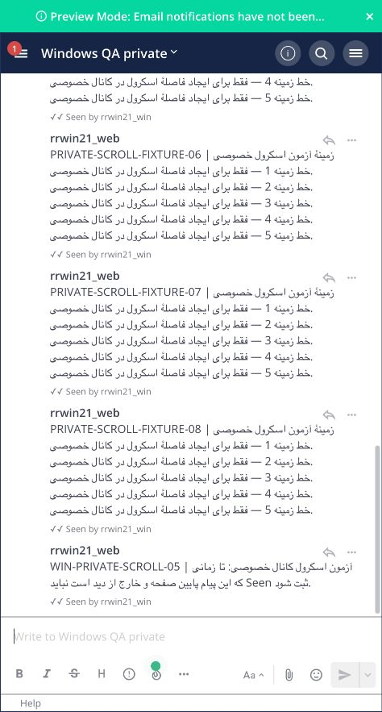
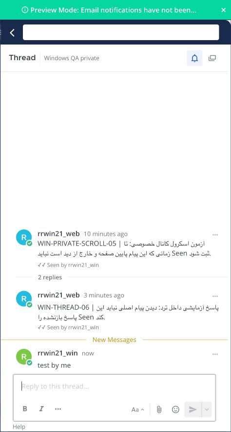

# Mattermost Read Receipts Plugin — WhatsApp- and Telegram-Style Seen Check Marks

Add automatic **read receipts**, **double-check Seen indicators**, and **per-message reader lists** to Mattermost. Senders can see **who has read a message** in direct messages, group messages, public channels, private channels and supported thread views.

The familiar idea is the same one people associate with Telegram and WhatsApp: a visible check-mark indicator answers “Has this message been seen?” This plugin displays **✓✓ Seen by …** using reader identities confirmed by the server. It is an independent Mattermost extension, not a WhatsApp or Telegram integration, and does not reproduce every delivery state, color, privacy setting or group-chat rule of those products.

[Download plugin](https://github.com/ghaffaria/Mattermost-Read-Receipts-plugin/releases/tag/v1.1.2) · [Android APK](https://github.com/ghaffaria/Mattermost-Read-Receipts-plugin/releases/tag/v1.1.1-android-2.46.0-rr.1) · [Installation](docs/INSTALLATION.md) · [Architecture](docs/ARCHITECTURE.md) · [Test results](docs/VALIDATION.md) · [Windows validation](docs/WINDOWS.md) · [MPL-2.0](LICENSE)

## Why add read receipts to Mattermost?

Teams often need to distinguish a message that was posted from one that a recipient actually opened and viewed. This matters when coordinating incident response, handing over work, sharing an operational update, or following up on a question without repeatedly asking everyone whether they saw it.

Read receipts have been a recurring Mattermost community request over multiple years. A [2021 Mattermost GitHub discussion](https://github.com/mattermost/community/discussions/94) explicitly requested WhatsApp-like receipts. In a [2023–2025 forum thread](https://forum.mattermost.com/t/read-receipts-not-available/15290), users asked about availability, and a July 2024 Mattermost response described the feature as one of the highest-voted UserVoice requests during the preceding quarter. The [2024 design preview](https://forum.mattermost.com/t/design-preview-read-receipts-for-dms-gms/19254) collected customer feedback and considered other messaging products.

This project addresses that documented need with explicit receipts rather than inferring readership from a channel's unread counter. See [community requests and design background](docs/COMMUNITY_REQUESTS.md) for dated sources and the distinction between automatic Seen status and manual acknowledgement.

## What the plugin does

- **Mattermost message read status:** displays `✓✓ Seen by …` for server-confirmed readers.
- **Per-message receipts:** each message has its own set of readers and first-read timestamps.
- **Public and private channel read receipts:** supports channel conversations as well as DMs and group messages.
- **Thread read receipts:** a reply has an independent receipt; seeing its parent does not automatically mark the reply as seen.
- **Continuous visibility:** the default is two uninterrupted seconds in an active conversation and focused, visible client.
- **Offscreen protection:** being in the right channel does not count as seeing a message below the current scroll position.
- **Background protection:** hidden, minimized or unfocused clients should not create new receipts; supported cases are covered by paired negative/positive tests.
- **Live updates and history:** authors receive receipt changes and can recover existing Seen state after navigation or reopening.
- **Authenticated access:** server-side checks require a valid user and channel membership.
- **Data retention controls:** automatic receipt cleanup is opt-in and disabled by default.

### When does a message become Seen?

| Recipient state | Expected result |
|---|---|
| Message delivered, conversation unopened | No receipt |
| Channel open, target below the visible message list | No receipt |
| Parent message visible, thread reply unopened | No receipt for that reply |
| Client hidden, minimized or unfocused | No new receipt |
| Target meets the visibility threshold for the full dwell interval | Server records the first read; sender sees the reader |
| Sender views their own post | Sender is not added as their own reader |

Seen is an observation of client visibility, not proof of comprehension, agreement or action. For long posts, the visibility rule does not guarantee every line has been read. It also does not mean that a mere server acknowledgement or a notification preview counts as a read.

## Downloads and supported clients

Current plugin release: **1.1.2**. Compatible derived Android release: **2.46.0-rr.1**.

| Download | Purpose |
|---|---|
| [mattermost-readreceipts-1.1.2.tar.gz](https://github.com/ghaffaria/Mattermost-Read-Receipts-plugin/releases/download/v1.1.2/mattermost-readreceipts-1.1.2.tar.gz) | Server plugin for Linux amd64 and arm64; includes web client bundle and license notices |
| [Corresponding plugin source](https://github.com/ghaffaria/Mattermost-Read-Receipts-plugin/releases/download/v1.1.2/mattermost-readreceipts-1.1.2-source.tar.gz) | Source accompanying the MPL-covered plugin release |
| [Android APK release](https://github.com/ghaffaria/Mattermost-Read-Receipts-plugin/releases/tag/v1.1.1-android-2.46.0-rr.1) | Separately installed arm64 Android QA app implementing the custom receipt protocol |
| `SHA256SUMS` in each release | Integrity verification for that release's downloads |

Web browsers and the official Windows/macOS desktop apps use the server-provided web plugin. No custom Windows or Mac executable is needed for this feature. For Android, use the derived client: the unchanged official mobile app does not implement this plugin's explicit visibility protocol.

The Android app is based on Mattermost Mobile **v2.46.0**, commit `655df13b131da6810f4f073622c925af1b87c3fb`. Package `com.pardis.mattermost.readreceipts.qa` installs alongside the official app and uses a separate login and app data. It is QA-signed, arm64, minimum Android API 30 and target API 36. **Custom Firebase/HPNS push is not configured or qualified.** [Android build and installation](docs/ANDROID.md).

## Compatibility and validation

The isolated lab used **Mattermost Enterprise 12.0.1**, build **39742891057**, database schema **234**, and **PostgreSQL 17.12** with an Entry license. A manifest minimum version is not a claim that every newer or older release has been tested.

- **Windows desktop ↔ web:** official Windows app in UTM; public/private channel messages, offscreen scroll, minimize/restore and closed/open private-thread replies passed the documented tests. Reverse-direction messages had valid web-reader receipts. Exact Windows and desktop app versions were not recorded. [Evidence and boundaries](docs/WINDOWS.md).
- **macOS desktop, web and Android:** installed Mac desktop **6.3.2** and two Android 16/API 36 arm64 emulators. Android-to-Android, Android-to-web and Android-to-Mac communication were tested in both directions.
- **Selective readers:** earlier five-member Android/web/Mac fixtures verified different reader subsets for different messages. These results are separate from the later two-client Windows exercise.
- **Automated checks:** plugin source Go race tests, 13 web tests and TypeScript checks passed for the licensing/attribution release. Native Android validation is documented separately.

Most live UI evidence used plugin **1.1.1**. Version **1.1.2** adds licensing, developer attribution, packaging notices and the activation version log; receipt logic is unchanged. Full live UI coverage was not repeated for that metadata release. Physical Android devices, other Android API levels, iOS, HA/load and production Enterprise Advanced policies are not certified. **No production deployment was performed.** See [complete validation and retained exceptions](docs/VALIDATION.md).

## Screenshots

Screenshots use synthetic lab accounts. Some captured test messages are in Persian; those original evidence images are retained without translation or alteration.







## Install and verify

1. Verify the plugin archive against its release's `SHA256SUMS`.
2. Back up PostgreSQL, uploaded files, configuration and the previous plugin package before changing an existing deployment.
3. Upload the archive in Mattermost System Console plugin management, enable the plugin and review its settings.
4. Test with separate sender and reader accounts. Confirm no Seen while a target is unopened, offscreen or minimized, then confirm the correct reader after viewing.
5. Rehearse on the real Mattermost version, license policy, reverse proxy and TLS path before a production rollout.

Read the [installation, preservation and rollback guide](docs/INSTALLATION.md). Neither opening this repository nor installing the Android app requires clearing existing user data.

## Build the plugin from source

Requirements: Go, Node.js/npm and Python 3. Use pinned dependencies from the lockfiles.

```sh
npm ci --prefix webapp
go test -race ./...
npm test --prefix webapp
python3 build/build.py
```

The build performs TypeScript checking, builds the web plugin, compiles Linux amd64/arm64 binaries and packages licenses with the archive. `make test` and `make dist` are also available when a working Make toolchain is installed. Output: `dist/mattermost-readreceipts-1.1.2.tar.gz`.

## Frequently asked questions

### How can I see who read my Mattermost message?

Install and enable this plugin on a compatible server, then use a client that implements its protocol. After a recipient meets the continuous visibility rule, the sender's message displays the reader in the Seen indicator. Opening a channel alone is insufficient.

### Are these WhatsApp blue ticks or Telegram double checks?

The familiar read-confirmation idea is similar, but this implementation uses its own `✓✓ Seen by …` display and per-message reader list. It does not promise the same blue color, sent/delivered state machine or privacy behavior as either messenger.

### Does it work in Windows and Mac Mattermost desktop apps?

Yes within the documented test scope. Desktop apps load the web plugin supplied by the server. Windows/macOS compatibility evidence and untested cases are recorded in the validation guides.

### Does the official Android app support these custom read receipts?

The unchanged official app does not emit this plugin's visibility-based receipts. The separately installed derived Android app is provided for this protocol; it does not replace the vendor app.

### Is Seen the same as acknowledging an important message?

No. Seen records the visibility condition. A deliberate acknowledgement is a different action and should not be inferred from this status.

### Can this repository appear in Google search?

The repository is currently private. Its documentation is prepared for public discovery, but private content is not publicly crawlable. Public availability and search-engine indexing are separate decisions, and no search ranking is promised.

## License and source availability

Original project code is licensed under [Mozilla Public License 2.0](LICENSE). [Licensing scope](LICENSING.md) explains third-party boundaries and the unchanged Android patch/APK licensing. Plugin 1.1.2 contains **Developed by Alireza Ghaffari** and a clickable profile link in its settings. Dependency notices are preserved.

Binary recipients must have access to the corresponding covered source; a source archive accompanies the plugin release. The repository remains private until its owner chooses otherwise. Historical releases and original test evidence are retained; this documentation update does not rebuild the plugin or APK.
