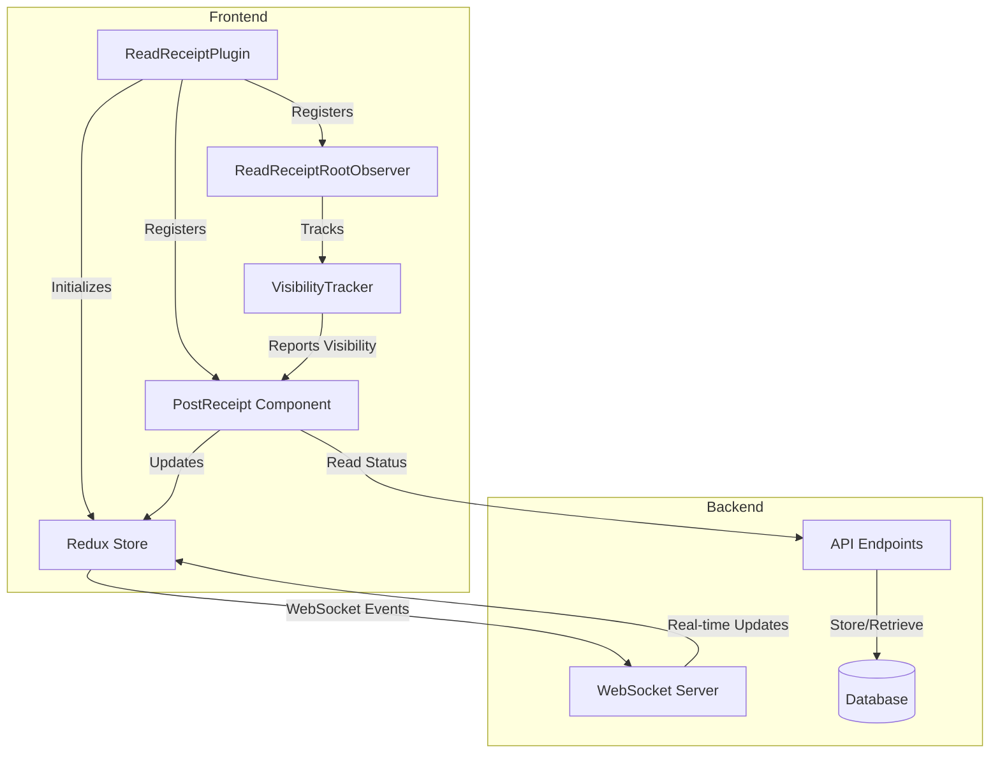
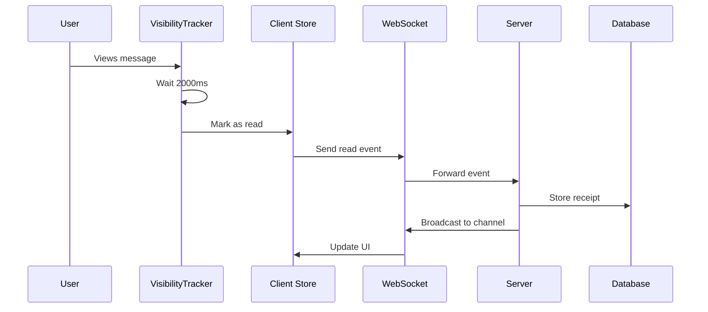

# Mattermost Read Receipts Plugin

<p align="center">
  
  
</p>

WhatsApp/Telegram-style **"Seen by..."** indicators for Mattermost. Get real-time visibility into who has read your messages.

<p align="center">
  
  
</p>

---

## ✨ Features

- **Real-time read receipts** — See who has read your messages instantly
- **Works everywhere** — Direct messages, group messages, and channels
- **Smart detection** — Messages must be visible for 2+ seconds to count as "read"
- **Persistent** — Receipts survive page refreshes and server restarts
- **Automatic cleanup** — Old receipts are purged based on retention settings
- **Modern UI** — Clean, inline "Seen by..." badges

---

## 📦 Installation

1. Download the latest `mattermost-readreceipts-*.tar.gz` from releases
2. Go to **System Console → Plugins → Plugin Management**
3. Upload and enable the plugin
4. Done! Receipts will appear next to messages

---

## ⚙️ Configuration

Navigate to **System Console → Plugins → Read Receipts**

| Setting | Default | Description |
|---------|---------|-------------|
| **Enable Read Receipts** | `true` | Master on/off switch |
| **Visibility Threshold** | `2000ms` | How long a message must be visible to be marked as read |
| **Retention Days** | `30` | Automatic cleanup of old receipts |
| **Log Level** | `info` | Set to `debug` for troubleshooting |

---

## 🔧 Compatibility

| Component | Minimum Version |
|-----------|-----------------|
| Mattermost Server | v6.0+ (Team or Enterprise) |
| PostgreSQL | 13.x+ |
| MySQL/MariaDB | 8.0+ / 10.6+ |

> **Note:** The plugin uses Mattermost's existing database connection. Ensure the DSN is properly configured in **System Console → Environment → Database** (not masked).

---

## 🏗️ Building from Source

```bash
git clone https://github.com/<your-org>/mattermost-readreceipts.git
cd mattermost-readreceipts

# Build everything
make dist

# Output: dist/mattermost-readreceipts-<timestamp>.tar.gz
```

### Development with Docker

```bash
docker-compose up -d        # Start Mattermost + Postgres
make dev                    # Build and deploy to running instance
```

---

## 🔌 Architecture

### Component Overview



### Message Read Flow



---

## 🚨 Troubleshooting

| Issue | Solution |
|-------|----------|
| Receipts don't appear | Check browser console for errors; refresh the page |
| Plugin won't activate | Verify database DSN is not masked in System Console |
| "Seen by" missing after channel switch | This was fixed in the latest version - please update |
| Receipts not updating in real-time | Check WebSocket connection in browser DevTools |

### Debug Mode

Enable verbose logging in browser console:

```javascript
window.__DEBUG_RR__ = { verbose: true };
```

---

## 📡 API Reference

### REST Endpoints

| Method | Endpoint | Description |
|--------|----------|-------------|
| `POST` | `/plugins/mattermost-readreceipts/api/v1/read` | Mark a message as read |
| `GET` | `/plugins/mattermost-readreceipts/api/v1/receipts?channel_id=...` | Get receipts for channel |
| `GET` | `/plugins/mattermost-readreceipts/api/v1/channel/{id}/reads` | Get channel-level reads |
| `GET` | `/plugins/mattermost-readreceipts/api/v1/debug/ping` | Health check (admin only) |
| `GET` | `/plugins/mattermost-readreceipts/api/v1/debug/db` | Database status (admin only) |

### WebSocket Events

| Event | Payload | Description |
|-------|---------|-------------|
| `custom_mattermost-readreceipts_read_receipt` | `{ MessageID, UserID, ChannelID, ReaderIDs }` | Sent when message is read |
| `custom_mattermost-readreceipts_channel_readers` | `{ ChannelID, LastPostID, UserIDs }` | Channel-level update |

---

## 🗄️ Database Schema

The plugin automatically creates these tables:

### PluginReadReceipts
Per-message read tracking.

| Column | Type | Description |
|--------|------|-------------|
| message_id | TEXT | Post ID (PK) |
| user_id | TEXT | Reader's user ID (PK) |
| channel_id | TEXT | Channel ID |
| timestamp | BIGINT | When read (milliseconds) |

### channel_reads
Channel-level read status.

| Column | Type | Description |
|--------|------|-------------|
| channel_id | TEXT | Channel ID (PK) |
| user_id | TEXT | User ID (PK) |
| last_post_id | TEXT | Last seen post ID |
| last_seen_at | BIGINT | Timestamp (milliseconds) |

---

## 🤝 Contributing

1. Fork the repository
2. Create a feature branch from `main`
3. Make your changes with tests
4. Submit a pull request

---

## 📄 License

[MIT](LICENSE)

---

## 🙏 Acknowledgements

- Mattermost team for the plugin framework
- All contributors and testers

---

## 🚀 Production Readiness

### ⚠️ Considerations Before Production

| Concern | Recommendation |
|---------|----------------|
| **Load Testing** | Not tested with 100+ concurrent users. Recommend testing in staging first. |
| **Database Growth** | Monitor `PluginReadReceipts` table size. Set appropriate `RetentionDays`. |
| **Browser Compatibility** | Tested in Chrome. Recommend testing in Firefox/Safari/Edge. |
| **Mobile Apps** | May not work in Mattermost mobile apps (React Native). |
| **Performance Impact** | Each message view triggers an API call. High-traffic channels may see increased load. |

### 🔴 Recommended Pre-Production Checklist

- [ ] Test in staging environment with real users for 1-2 weeks
- [ ] Monitor database - Set `RetentionDays` to 30 or less
- [ ] Check server logs - Watch for any backend errors
- [ ] Test with multiple browsers - Ensure cross-browser compatibility
- [ ] Backup database before enabling in production

### �� Honest Assessment

| Rating | Score |
|--------|-------|
| **Stability** | 7/10 - Core features work, but not battle-tested at scale |
| **Completeness** | 8/10 - All planned features implemented |
| **Code Quality** | 7/10 - Functional with some workarounds for edge cases |
| **Production Ready** | **70%** - Safe for small teams, recommend staging for larger deployments |

### 💡 Recommendation

**For small to medium teams** (< 50 users): Safe to deploy with monitoring.

**For large organizations** (100+ users): Deploy to staging first for 1-2 weeks, then gradually roll out.
