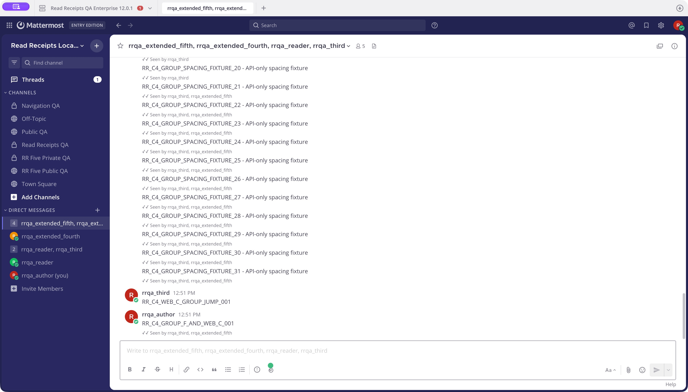
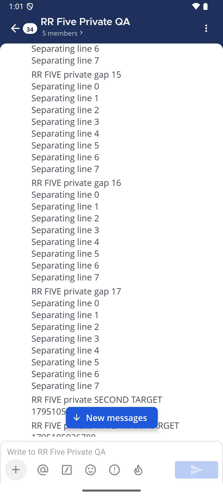
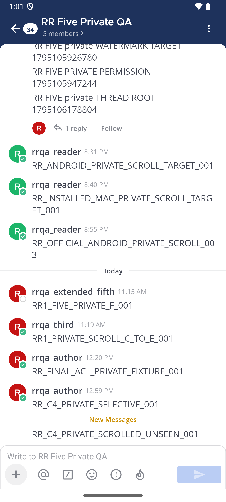
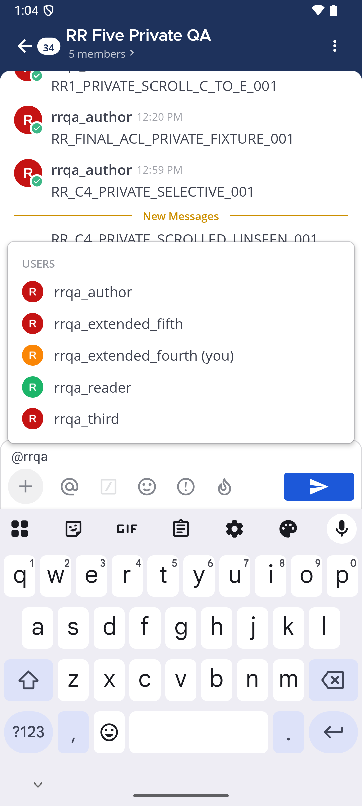
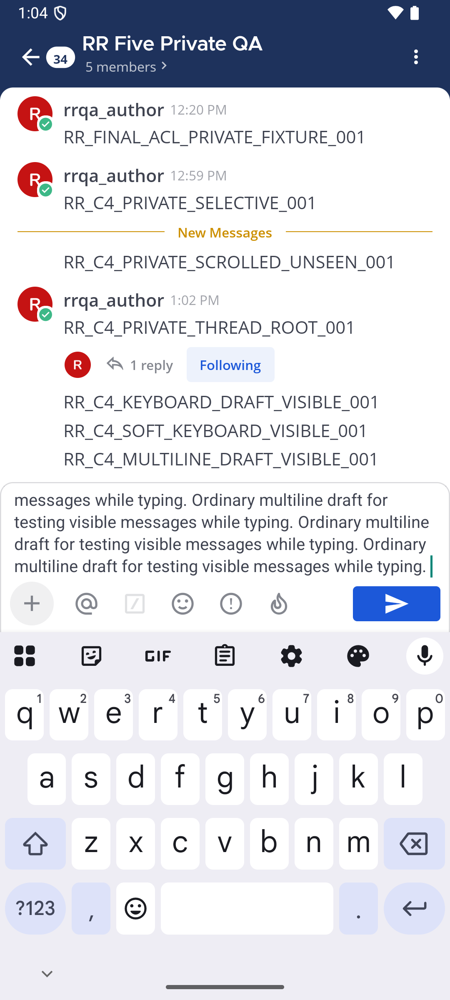
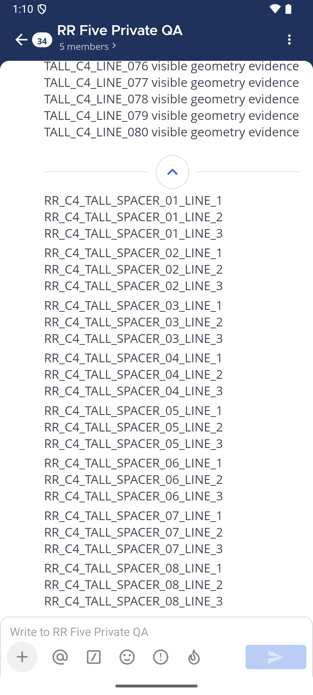
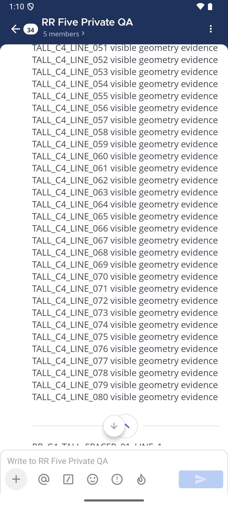

# گزارش آزمون — ۲۰۲۶/۱۱/۲۱

محیط: Enterprise12.0.1، build39742891057، schema234، PostgreSQL17.12 با مجوز Entry؛ دسکتاپ نصب‌شدهٔ مک6.3.2 و دو شبیه‌ساز Android16/API36/arm64. سیاست‌های Enterprise Advanced پروداکشن تأیید نشده و پروداکشن تغییر نکرده است.

پلاگین1.1.1 و اندروید2.46.0-rr.1(candidate4) بررسی شدند.۳۲سناریوی هدف و۹fixture کمکی ثبت شده‌اند؛ fixture آزمون پذیرش مستقل نیست. کاربران ساختگی۱دسکتاپ،۲و۳وب،۴و۵اندروید هستند.

- هر شش جهت اندروید↔اندروید/وب/دسکتاپ با ارسال واقعی از رابط و خوانندگان دقیق پاس شدند؛ فرستنده خوانندهٔ خودش نشد.
- در عمومی پنج‌نفره فقط۲و۴، در خصوصی فقط۳و۴ رسید گرفتند. دو پیام گروه به‌ترتیب فقط۲و۴ و۳و۵ را داشتند؛ رسید پیام اول به دوم ارث نرسید.
- در عمومی/خصوصیِ اسکرول‌بالا، هدف۶٫۶۹۶/۶٫۵۱۰ثانیه بدون Seen ماند؛ همان هدف پس از پایین‌رفتن رسید گرفت.
- پاسخ بستهٔ ترد بیش از۶٫۵ثانیه بدون رسید بود؛ پس از بازشدن Thread فقط۴رسید گرفت.
- نوار اعلان و شروع سرد زیر آن۶٫۶۸۵/۶٫۶۵۱ثانیه بدون رسید بودند. مشاهدهٔ حدود۸۰۰تا۸۵۰میلی‌ثانیه و سپس۶٫۵۴۱ثانیه پوشش، Seen نساخت؛ بازگشت دورهٔ تازه لازم داشت.
- صفحه‌کلید و کادر چندخطی viewport را واقعاً کوچک کردند. پیشنهادهای تایپ۶٫۵۰۷ثانیه هدف را پوشاندند؛ پس از بسته‌شدن همان پیام Seen گرفت.
- پیام بازشدهٔ۸۰خطی با پوشش۲۳٫۵٪viewport برای۶٫۷ثانیه Seen نگرفت؛ با۹۸٫۵٪فقط۴رسید گرفت. حد نمایش۵۰٪کوچک‌تر ارتفاع ردیف و viewport است و به معنی خواندن همهٔ خطوط نیست.
- چهار پیام در۱۱۱٫۴۹۹ثانیه بدون تعویض گفتگو یا process رسیدند. سه اتصال مجدد واقعی و یک پیام تازه پس از۳۵ثانیهٔ دیگر پاس شدند؛ شکاف sequence یا خطای WebSocket مشاهده نشد.
- restart نشست، تک‌ردیف رسید و زمان نخست را حفظ کرد. درخواست عضو نبودن در خصوصی GET/POST403گرفت.

## بررسی فنی و حفظ داده

Jest:۱۵۴/۱۵۴ در۱۳suite؛ SDKواقعی:۶۱/۶۱؛ JVM:۸/۸. TypeScript و lint پاس شدند.۳۹فایل سورس و۱۲فایل SDK با ساختC4 تطبیق دارند. هش APK واقعاً نصب‌شده روی هر دو شبیه‌ساز مطابق انتشار است. داده‌ها، حساب‌ها، رسیدهای قبلی و شش فایل فیزیکی حفظ شدند؛ داده و مشاهدهٔ آزمایشی مجاز اضافه شد. اپ رسمی پاک یا بازنویسی نشد؛ تنظیمات موقت ورودی شبیه‌ساز به اصل برگشت. snapshot خصوصی دیتابیس و اطلاعات ورود منتشر نمی‌شوند.

## استثناها و محدودیت‌ها

انتظار اولیهٔ «بدون Seen» در یک تست ایموجی اشتباه بود: پیام کاملاً بالای صفحه‌کلید inline دیده می‌شد و رسید پس از۲۵۵۷میلی‌ثانیه معتبر بود. FAIL اولیه حفظ و نامعتبر بودن انتظار مشخص شد؛ حالت مثبت پاس شد. بخش منفی tooltip اولیهٔ رنگ پوست فقط شاهد API دارد و تصویر منفی ندارد.

یک ناوبری وب در گروه رویLoadingماند و timeoutشد؛ ارسال از رابط و بازکردن دوباره بازیابی کرد و خوانندگان درست تأیید شدند. علت اثبات نشده است. candidate2 در دریافت زنده شکست خورد؛ ایراد اتصال هم‌زمان اصلاح و رویC4 تکرار شد. candidate3 پیش از نصب کنار گذاشته شد. همهٔ فرمان‌های اولیه PASS معرفی نمی‌شوند.

ارتفاع کامل پیام بلند از تعداد خط استنباط شده است. کلیک واقعیCancel نوار خوانده‌نشده و تماس زنده آزمون نشده‌اند. گوشی واقعی، APIهای دیگر، iOS، چرخش/چندپنجره،HA/بار و سیاست پروداکشن تأیید نشده‌اند. Push اختصاصی تنظیم نشده و امضاQAاست.

## تصاویر

