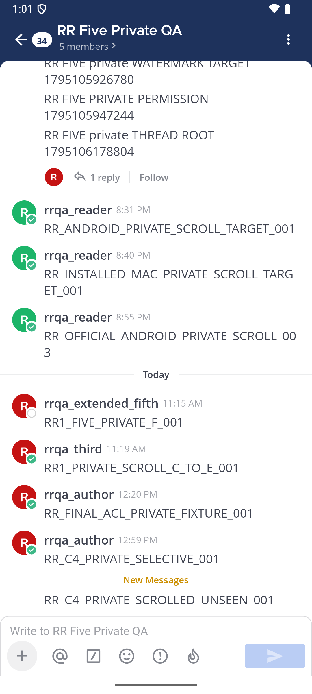
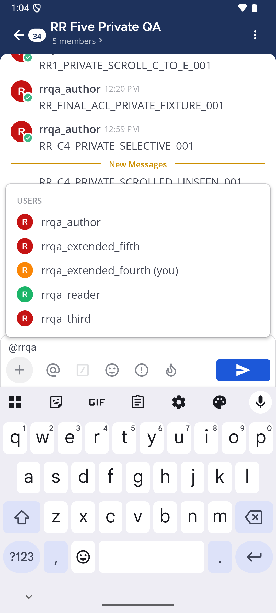

# Validation — 1.1.3 (2026-11-22)

## Production incident clarification

On 2026-11-22, the maintainer reported that the original production incident (missing Seen lists in the desktop client) was resolved by logging out and logging back in once while the previous plugin version was still installed. Version 1.1.3 had not been deployed at the time of that report. **The resolution of that incident must not be attributed to 1.1.3.** The precise production root cause remains unconfirmed; the laboratory RPC findings are separate evidence. This operator-reported recovery is not a production validation of 1.1.3 or proof of the incident's root cause.

## Release validation and boundaries

The 1.1.3 distribution preserves the receipt protocol and Android APK. Go race tests, 13 web-controller/visibility tests, TypeScript checks, four package tests, four lab-installer tests and one source-export boundary test passed. The source archive includes the explicitly curated public docs/evidence and unchanged mobile reproduction manifests; private local evidence, credentials, keys and database snapshots are excluded.

RPC failure/recovery was exercised on 1.1.3-rc.1 by intentionally pausing the plugin process. The observed health-check-failure-to-reactivation interval decreased from 14.885 seconds on 1.1.2 to 0.401 seconds on the candidate. These are single controlled observations in the local Docker Desktop lab, not a production benchmark. The external trigger of the unplanned laboratory pause was not captured. See [RPC findings and recovery scope](RPC_RECOVERY.md).

The final 1.1.3 package was also tested in the isolated Enterprise 12.0.1/build 39742891057/schema 234/PostgreSQL 17.12 lab. The installed macOS Desktop 6.3.2/build 408386646761 used a dedicated profile containing only local staging servers on ports 18065 and 19065. The source server was Team Edition 12.1.0. Browser tests used the existing Playwright installation because the Browser plugin was unavailable.

The author stayed logged into the source desktop server while a conversation was sent and viewed only in web on the target. Two web readers produced the same Seen list in web. After desktop logout from the source, selection of the target, and login to the target, the existing readers were shown without reloading the page. Logout/login was repeated. No API-created message or receipt was used in this scenario.

Original posts, receipts and first-read timestamps were preserved in the checks against the pre-test records. The final host health-check setting was restored to enabled. No production deployment or production validation of 1.1.3 was performed. Android and Windows were not requalified for 1.1.3; their historical evidence and limitations remain below.

## Historical Android and desktop validation — 2026-11-21

Environment: Enterprise12.0.1/build39742891057/schema234/PostgreSQL17.12, Entry license; installed macOS Desktop6.3.2; two Android16/API36 arm64 emulators. The production Enterprise Advanced environment was not accessed/deployed. Synthetic users:1 desktop author,2/3 web,4/5 native Android.

Plugin1.1.1 and Android2.46.0-rr.1(candidate4) were tested.32 target scenarios and9 supporting fixtures were recorded; fixtures are not independent acceptance tests.

| Scenario | Observed result |
|---|---|
| Android ↔ Android / Web / installed Mac Desktop | All six directions passed with real client UI messages, exact reader identities and author exclusion |
| Five-member public/private channels | Public: readers2+4; private:3+4; author1 and unseen members absent |
| Five-member group, two messages | First: readers2+4. Second:3+5. Reading second did not mark the older offscreen first |
| Public/private scrolled up | Target absent, no Seen for6.696/6.510s; same target Seen after scrolling into view |
| Collapsed reply / opened native Thread | No reply receipt≥6.5s while collapsed; E-only after opening |
| Notification shade / cold-start under shade | No Seen6.685/6.651s; correct receipt after restore; cold-start→shade98ms |
| Interrupted exposure | Visible~800–850ms then hidden6.541s without Seen; fresh dwell required on return |
| Software keyboard / multiline composer | Usable list ends1289/1136px; targets above composer receive valid Seen |
| Autocomplete covering target | No receipt6.507s; same message receives Seen after overlay closes |
| Expanded80-line post | Row23.5% viewport: no Seen6.700s; same post98.5% viewport: E-only Seen |
| Native connection soak | Four live targets over111.499s, same process/no navigation;3real reliable reconnects, no observed sequence gaps/errors; new target after35s further idle passed |
| Restart | Session retained, one receipt row and original first timestamps preserved |
| Private channel outsider | GET/POST403, no unauthorized write |

## Windows desktop follow-up

**PASS for the tested Windows ↔ web scenarios.** Public/private unopened messages, offscreen scroll, minimize/restore and closed/open thread responses were checked with paired negative/positive server evidence. Reverse-direction receipts and Windows rendering were also verified. These additional Windows tests are separate from the earlier 32 Android target scenarios. See [Windows validation](WINDOWS.md) for screenshots, evidence and operator-reported additional acceptance. Exact Windows/desktop version was not recorded.

## Automated and preservation checks

- Jest154/154 in13 suites; actual SDK source/CJS/module61/61; native JVM8/8(5new,3existing).
- TypeScript and lint passed.39 changed upstream files and12 SDK files match the C4 build; clean pinned-source reconstruction passed.
- Both installed APK hashes match the release. Existing official/older Android packages and custom first-install time stayed unchanged; temporary emulator input settings were restored.
- Original local data/authentication and6physical files were preserved. All original laboratory posts/accounts/channels/receipt timestamps were preserved; only authorized test data/reads were appended. Private database snapshots and credentials are not published.

## Retained exceptions and limits

An initial emoji negative expectation failed: the target was fully visible ABOVE the inline emoji keyboard, so Seen at create+2557ms was legitimate. The wrong expectation was retained and classified; the valid positive behavior passed. A first-time skin-tone tooltip negative had API evidence only; no archived negative frame.

One browser group navigation remained on Loading and timed out before target rendering. UI send/reopen recovered; correct readers were then verified. Root cause remains unproven. Earlier candidate2 failed sustained live delivery; its concurrent WebSocket lifecycle bug was fixed and retested in C4. Candidate3 was withdrawn before installation after teardown review. These are not represented as clean initial command passes.

Visibility means50% of min(row height, usable viewport) for2continuous seconds; it does not prove comprehension or reading every line of a tall post. Tall full height>4500px is inferred from80lines, not measured from clipped bounds. Actual unread-banner Cancel interaction and live calls were not exercised. No physical-device/otherAPI/iOS/rotation/multiwindow/HA/load/production-policy or push certification. Custom Firebase/HPNS push remains unconfigured; artifacts are QA-signed.

## Screenshots

All accounts are synthetic. Screenshots are unaltered test captures.

