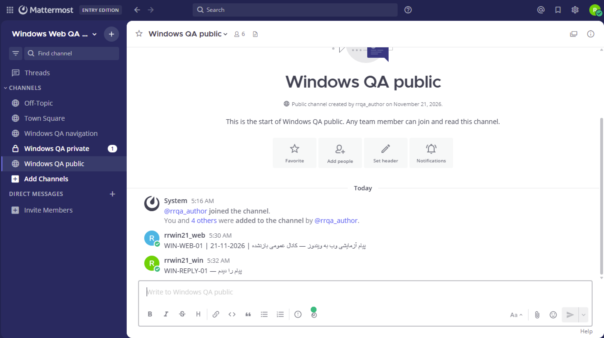
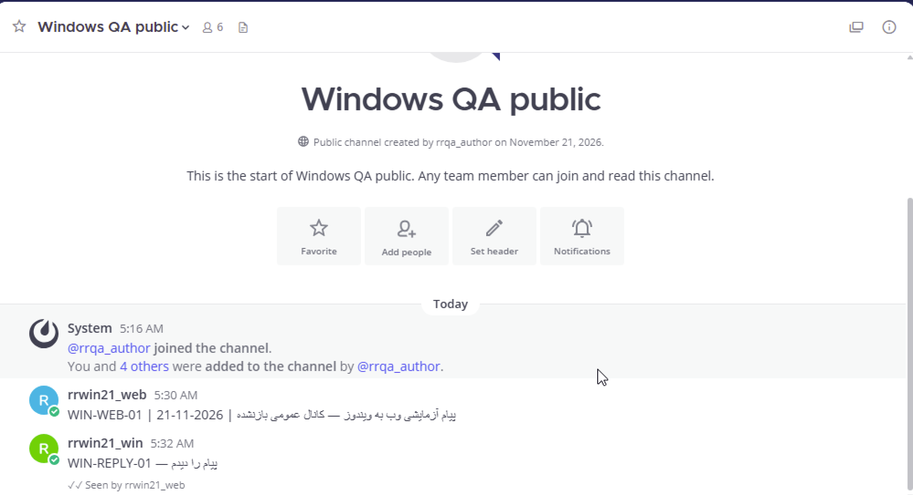
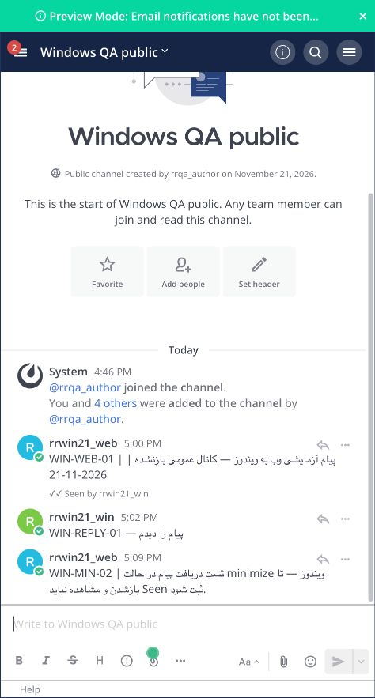
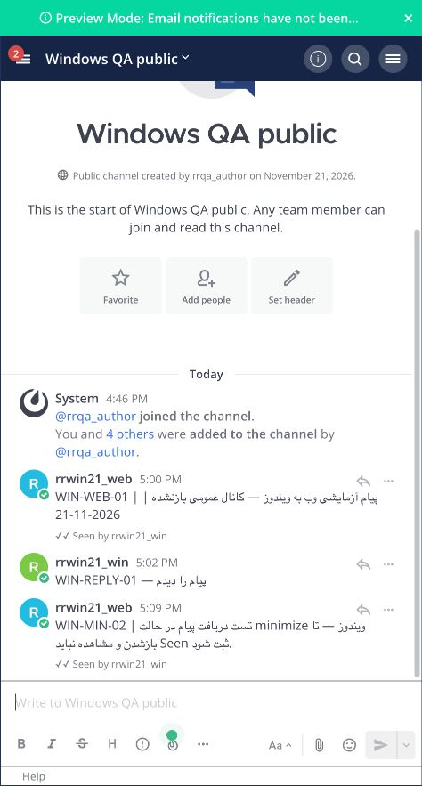
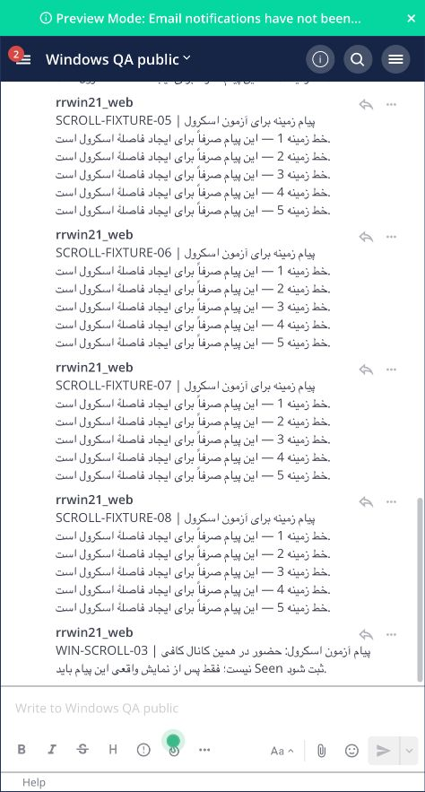
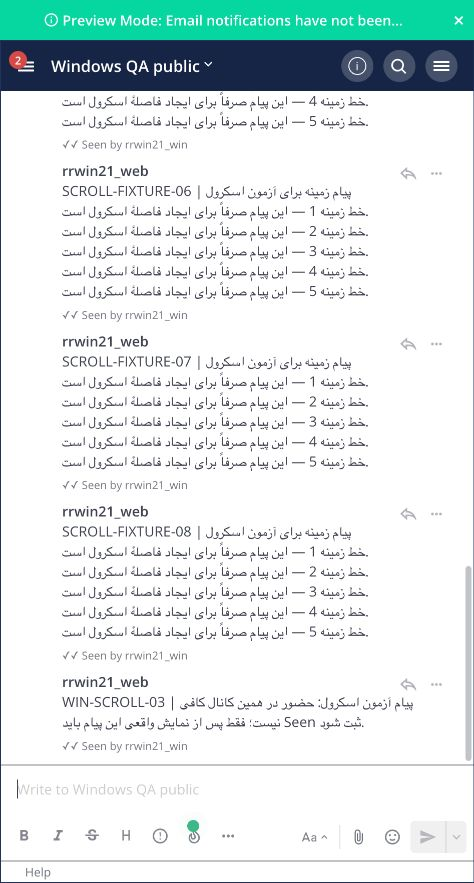
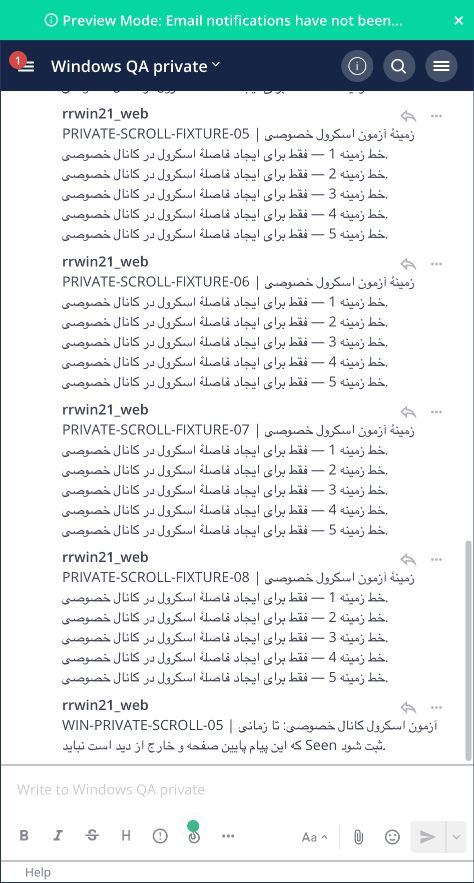
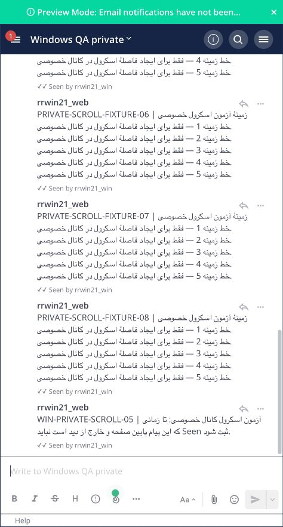
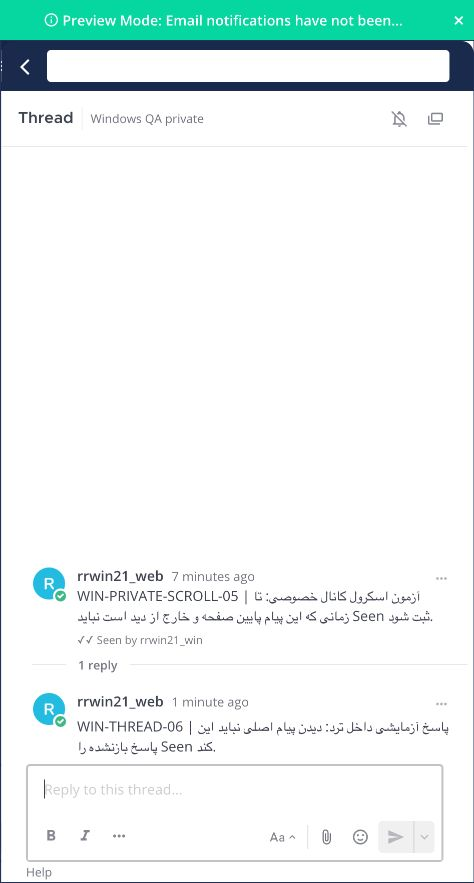
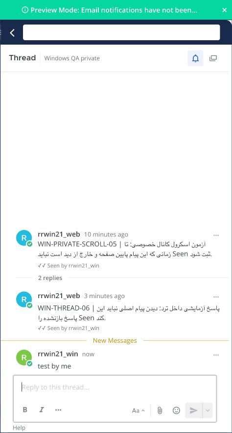

# آزمون دسکتاپ ویندوز — ۲۰۲۶/۱۱/۲۱

[English](WINDOWS.md) · [گزارش کلی](VALIDATION.fa.md)

**عملکرد دسکتاپ ویندوز ↔ وب در سناریوهای زیر تأیید شد.** آزمون با اپ رسمی نصب‌شده توسط کاربر در ویندوز UTM انجام شد؛ اپ ویندوز دستکاری نشد و بستهٔ مخصوص ویندوز لازم نبود. همان پلاگین **1.1.1** آزموده شد؛ فایل‌های انتشار بازسازی یا جایگزین نشدند.

## محیط و روش

آزمایشگاه محلی Enterprise **12.0.1**، build **39742891057**، schema **234**، PostgreSQL **17.12** با مجوز Entry. طرف ویندوز را کاربر و طرف وب را عامل با حساب ساختگی مجزا کنترل کردند. نسخهٔ دقیق ویندوز، نسخهٔ اپ دسکتاپ و معماری مهمان ثبت نشده است؛ نسخهٔ 6.3.2 مک را به ویندوز نسبت نمی‌دهیم. پروداکشن تغییر نکرد.

وضعیت پنجره، اسکرول و بازکردن ترد بر گزارش کاربر تکیه دارد. ارسال از رابط وب، نمایش Seen و رسیدهای زمان‌دار سرور مستقلاً بررسی شدند. دو تصویر ویندوز را کاربر فرستاده و سایر تصاویر از وب ثبت شده‌اند. کانال عمومی و خصوصی با احتساب مدیر آزمایشگاه شش عضو دارند؛ این نوبت آزمون انتخاب خوانندگان با پنج کاربر نیست.

## سناریوهای منفی و مثبت جفت‌شده

| سناریو | نتیجه | مشاهدهٔ منفی | شاهد |
|---|---|---|---|
| کانال عمومی بازنشده ← مشاهده | موفق | بدون رسید در نمونه‌ها تا سن پیام 35 ثانیه | [قبل](windows/evidence/01-unopened-public.json) / [بعد](windows/evidence/02-roundtrip-before-web-focus.json) |
| minimize ویندوز ← بازگشت و مشاهده | موفق | بدون رسید در نمونه‌ها تا سن پیام 43 ثانیه | [قبل](windows/evidence/04-windows-minimized.json) / [بعد](windows/evidence/05-windows-restored.json) |
| اسکرول عمومی؛ هدف خارج از صفحه ← مشاهده | موفق | بدون رسید در نمونه‌ها تا سن پیام 44 ثانیه | [قبل](windows/evidence/07-windows-scrolled-up.json) / [بعد](windows/evidence/08-windows-scroll-visible.json) |
| کانال خصوصی بازنشده ← مشاهده | موفق | بدون رسید در نمونه‌ها تا سن پیام 40 ثانیه | [قبل](windows/evidence/09-private-unopened.json) / [بعد](windows/evidence/10-private-visible.json) |
| اسکرول خصوصی؛ هدف خارج از صفحه ← مشاهده | موفق | بدون رسید در نمونه‌ها تا سن پیام 47 ثانیه | [قبل](windows/evidence/12-private-scrolled-up.json) / [بعد](windows/evidence/13-private-scroll-visible.json) |
| پیام اصلی دیده‌شده و ترد بسته ← بازکردن پاسخ | موفق | بدون رسید در نمونه‌ها تا سن پیام 45 ثانیه | [قبل](windows/evidence/14-thread-closed.json) / [بعد](windows/evidence/15-thread-visible.json) |

در هر جفت، همان پیام در نمونه‌های منفی رسید ویندوز نداشت؛ سپس دقیقاً یک رسید برای `rrwin21_win`، پس از آخرین نمونهٔ منفی ثبت شد و Seen در وب نمایش یافت. زمان‌های جدول سن پیام هنگام آخرین نمونه‌اند، نه ادعای پایش پیوسته از لحظهٔ ارسال یا اندازه‌گیری تأخیر خواندن. مجموعهٔ منفی هر مورد ۸ یا ۹ نمونه با فاصلهٔ حدود دو ثانیه دارد؛ مورد نخست عمومی شش نمونه دارد. مرز دقیق دوثانیه‌ای در این نوبت اندازه‌گیری نشده است.

## مسیر برگشت و تست‌های تکمیلی کاربر

پاسخ `WIN-REPLY-01` از ویندوز ارسال و در وب دیده شد؛ رسید `rrwin21_web` ثبت شد و تصویر ارسالی کاربر نمایش Seen در خود ویندوز را تأیید می‌کند. [شاهد سرور](windows/evidence/03-reply-after-web-focus.json).

[بازبینی نهایی رسیدها](windows/evidence/16-final-receipt-audit.json) رسید کاربر وب را برای پیام‌های تکمیلی کاربر در عمومی (`test by me from win in public`)، خصوصی (`test by me from win`) و پاسخ ترد (`test by me`) تأیید کرد؛ یک پیام خصوصیِ وب هم رسید ویندوز داشت. بنابراین هر دو جهت در عمومی، خصوصی و ترد خصوصی آزموده‌شده شاهد سرور دارند. شرایط منفی و وضعیت پنجره برای این پیام‌های تکمیلی بازسازی نشده است.

کاربر انجام بقیهٔ تست‌ها و مشاهدهٔ Seen را نیز اعلام کرده است؛ این مورد **پذیرش گزارش‌شده توسط کاربر** است، نه اثبات مستقل همهٔ سناریوها. در fixtureهای مخصوص ویندوز، دایرکت و گروه هنگام بازبینی پیام کاربری نداشتند. دایرکت/گروه ویندوز، انتخاب پنج خواننده، نمای مستقل Threads، اسکرول داخل ترد بلند، پوشیده‌شدن/فوکوس/قفل، Sleep/Resume و اتصال مجدد/restart با این شواهد تأیید نشده‌اند.

## حفظ داده و انتشار

فقط حساب‌ها، پیام‌های زمینه و رسیدهای آزمایشی به آزمایشگاه اضافه شدند؛ داده‌ای حذف نشد. رمز، توکن نشست و تنظیمات اجرا در شواهد منتشر نمی‌شوند. فایل‌های پلاگین و APK، امضای اندروید و هش‌های انتشار تغییری نکرده‌اند. ویندوز پلاگین وبِ ارائه‌شده از سرور را اجرا می‌کند و همان بستهٔ انتشار قبلی استفاده می‌شود.

## تصاویر

