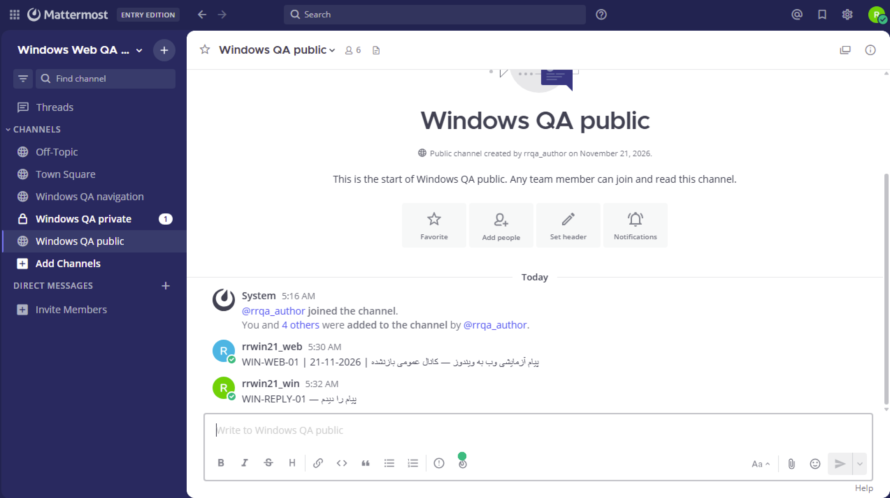
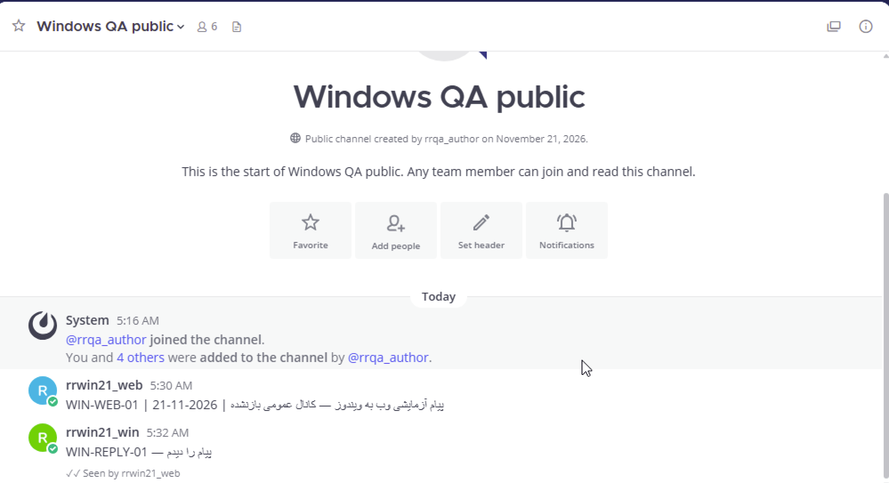
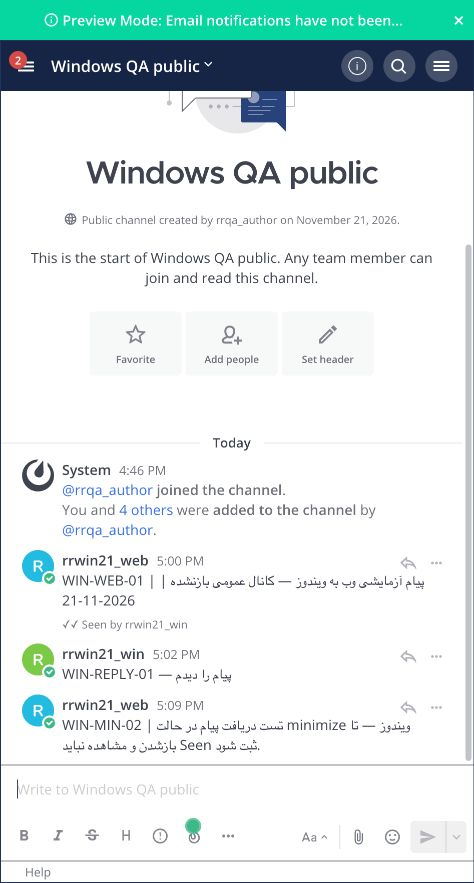
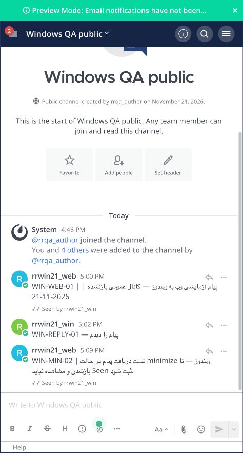
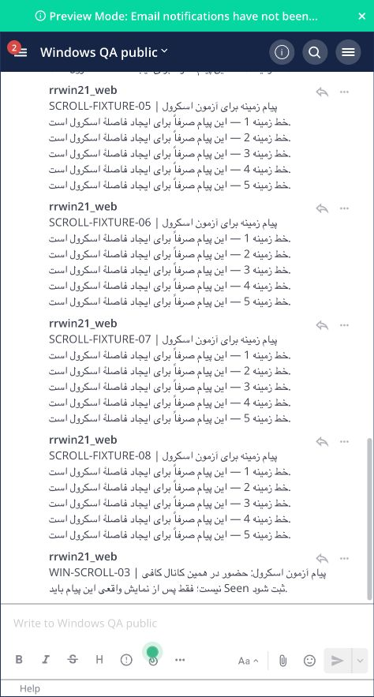
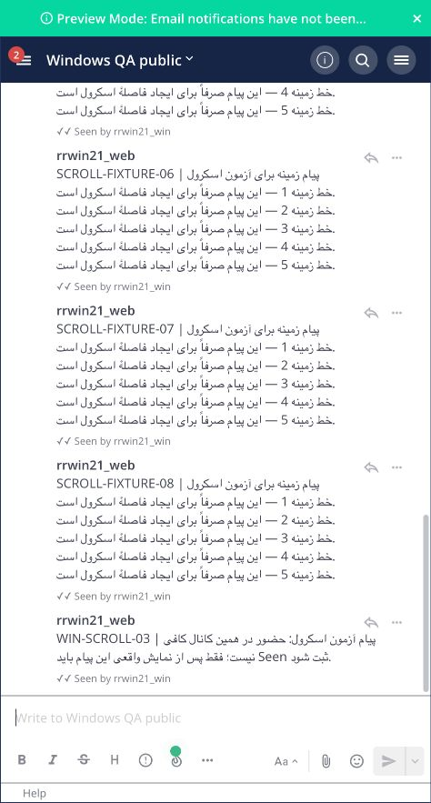
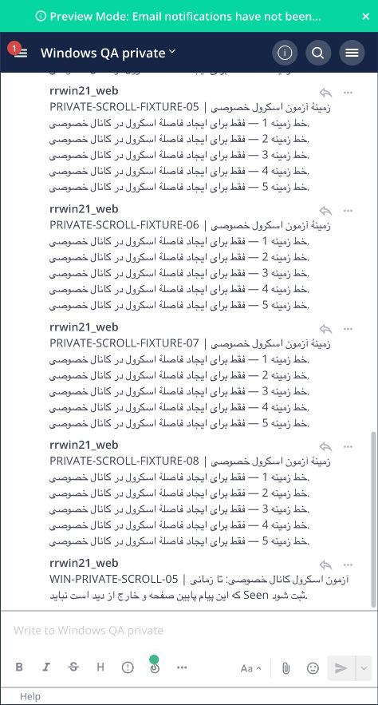
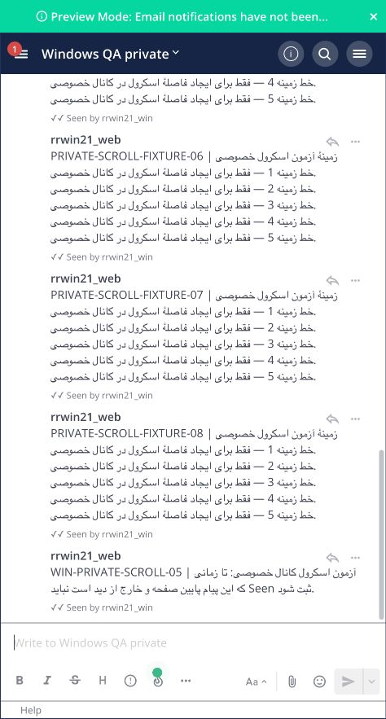
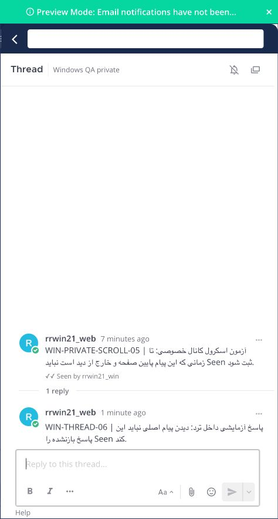
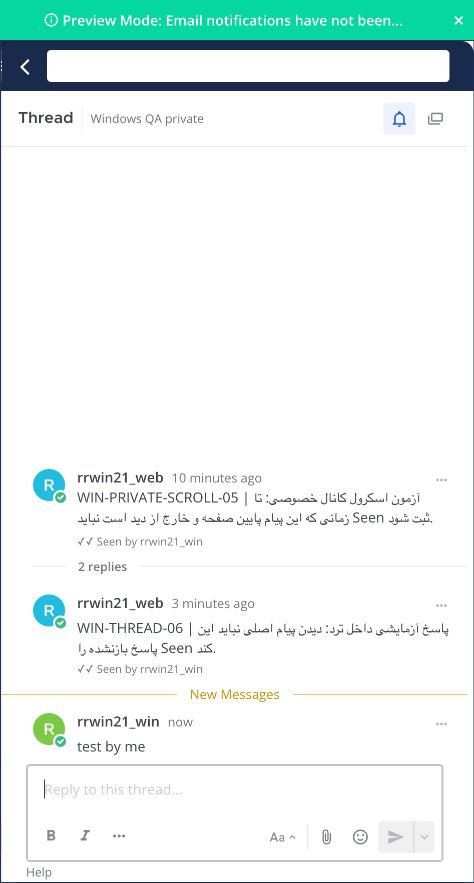

# Windows desktop validation — 2026-11-21

[Overall validation](VALIDATION.md)

**Windows desktop ↔ web: PASS for the scenarios below**, using the official Mattermost Windows app installed by the operator inside UTM. No Windows app modification or Windows-specific plugin package was required. This validates the existing plugin **1.1.1**; release binaries were not rebuilt or replaced.

## Environment and method

Isolated local Mattermost Enterprise **12.0.1**, build **39742891057**, schema **234**, PostgreSQL **17.12**, Entry license. Windows desktop was controlled by the operator; the web side used a separate synthetic account in the in-app browser. Exact Windows OS build, desktop app version and guest CPU architecture were not recorded: do not infer Windows desktop 6.3.2 from the earlier macOS test. Production was not accessed or changed.

Windows window state, scrolling and thread opening were reported by the operator. Browser sends, rendered Seen indicators and timestamped server receipts were independently checked. The two Windows screenshots below were supplied by the operator. Other screenshots are web captures. All accounts/messages are synthetic. Public/private channels had six members including the lab administrator; this run is not a five-reader selective-read validation.

## Paired negative / positive cases

| Scenario | Result | Negative observation | Evidence |
|---|---|---|---|
| Public channel unopened → viewed | PASS | No receipt in samples through post age 35s | [Before](windows/evidence/01-unopened-public.json) / [After](windows/evidence/02-roundtrip-before-web-focus.json) |
| Windows minimized → restored and viewed | PASS | No receipt in samples through post age 43s | [Before](windows/evidence/04-windows-minimized.json) / [After](windows/evidence/05-windows-restored.json) |
| Public channel scrolled above target → target viewed | PASS | No receipt in samples through post age 44s | [Before](windows/evidence/07-windows-scrolled-up.json) / [After](windows/evidence/08-windows-scroll-visible.json) |
| Private channel unopened → viewed | PASS | No receipt in samples through post age 40s | [Before](windows/evidence/09-private-unopened.json) / [After](windows/evidence/10-private-visible.json) |
| Private channel scrolled above target → target viewed | PASS | No receipt in samples through post age 47s | [Before](windows/evidence/12-private-scrolled-up.json) / [After](windows/evidence/13-private-scroll-visible.json) |
| Parent viewed, thread closed → reply opened and viewed | PASS | No receipt in samples through post age 45s | [Before](windows/evidence/14-thread-closed.json) / [After](windows/evidence/15-thread-visible.json) |

For each paired case the same target had no Windows receipt in the negative samples, then exactly one receipt for `rrwin21_win` after the last negative sample; the matching Seen indicator appeared in web. Times above are target age at the final sample, not a claim of continuous polling since send or measured read latency. Negative collection used 8–9 samples separated by about two seconds (six in the first public case). These tests do not measure the exact two-second dwell boundary.

## Windows-to-web and additional operator tests

`WIN-REPLY-01` was sent through Windows, received/viewed in web, and recorded a receipt for `rrwin21_web`. The operator screenshot confirms `Seen by rrwin21_web` in Windows. [Server evidence](windows/evidence/03-reply-after-web-focus.json).

A later [read-only receipt audit](windows/evidence/16-final-receipt-audit.json) also confirmed web-reader receipts for operator messages `test by me from win in public`, `test by me from win` in private, and the threaded reply `test by me`; a private web message had the Windows-reader receipt. Both directions therefore have server evidence in public/private and the tested private thread. Negative timing/window state for these additional messages was not reconstructed.

The operator additionally reported completing the remaining tests and observing Seen. This is recorded as **operator-reported acceptance**, not independent proof of every previously listed scenario. In the dedicated Windows test fixtures, DM/group had no user messages at audit time. Coverage for Windows DM/group, five-reader selection, global Threads, scrolling within a long thread, fully covered/unfocused windows, lock screen, sleep/resume and reconnect/restart remains unqualified by this evidence.

## Data and distribution

Only synthetic lab accounts, fixtures, posts and receipts were appended. Existing data was not deleted. Credentials, session tokens and runtime configuration are excluded from the published evidence. Production, Android signing and release asset hashes are unchanged. Windows uses the server-provided web plugin; continue using the existing release bundle.

## Screenshots

